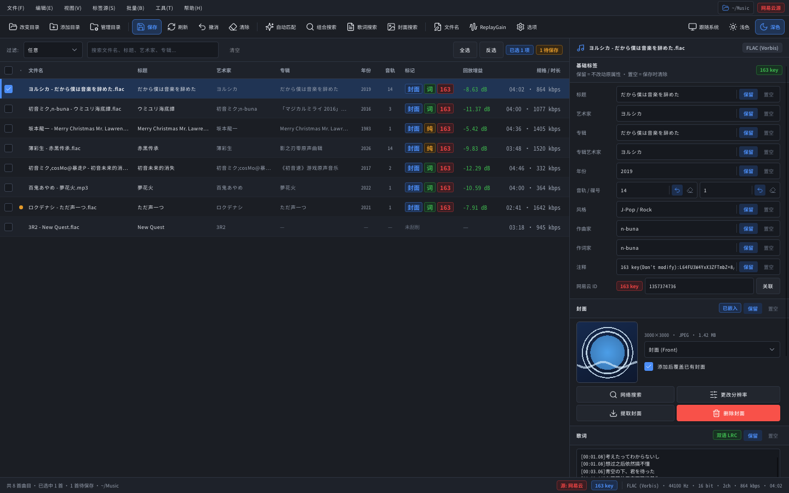
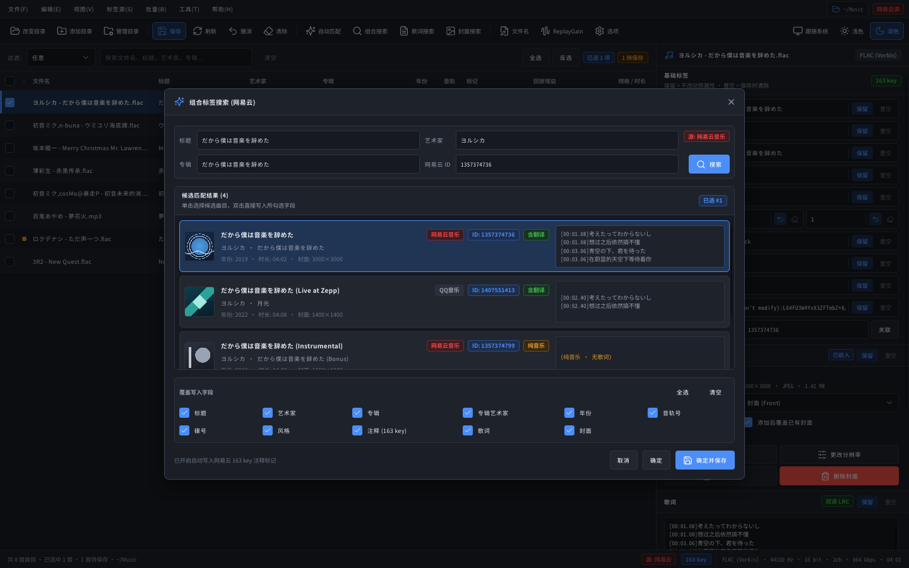
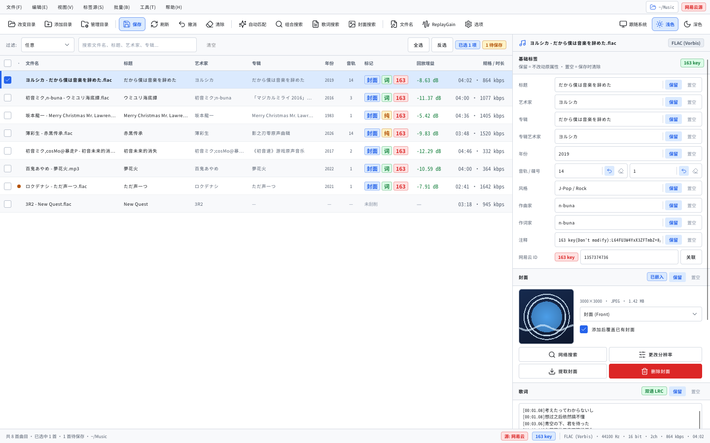

<div align="center">
  
  <h1>MusicTag Native (<code>musictag-rs</code>)</h1>
  <p>基于 <strong>Rust + Slint 1.19</strong> 构建的原生跨平台音频标签与网易云音乐刮削工具</p>
</div>

**MusicTag Native** 是参照 Windows 经典音频整理工具 MusicTag（v1.0.9.0）交互与功能打造的跨平台原生重构版本（支持 **Linux** 与 **Windows**），无需 `.NET` / `Wine` / `WebView`，界面与核心音频处理全链路原生编译运行。

---

## 界面预览

### 主界面（深色模式）


### 组合标签搜索与双语歌词预览


### 主界面（浅色模式）


---

## 核心特性

### 1. 网易云音乐元数据、双语歌词与 `163 key` 关联
- **在线刮削与自动搜索**：支持歌曲元数据（标题、艺术家、专辑、发行年份、音轨号等）、高清专辑封面及歌词搜索；打开「组合搜索」「搜索歌词」「搜索封面」弹窗时自动填充条件并触发搜索。
- **双语歌词清洗对齐**：支持原文/译文同时间戳合并（如 `[MM:SS.xx]原文\r\n[MM:SS.xx]译文`）、清理头部作词作曲信息、移除空行、统一两位数时间戳，以及按规则跳过 `"纯音乐，请欣赏"` / 纯音乐曲目的歌词写入。
- **网易云 `163 key` 注释关联**：支持写入并解析 AES-128-ECB 加密的 `163 key(Don't modify):...` 注释字段，便于本地音乐文件关联到网易云曲库 ID。
- **非侵入式写入**：缺失或冗余属性不强行补写——自动忽略单碟默认的碟号（如 `"01"` / `"1"` / `"1/1"`），且当专辑艺术家缺失或与曲目艺术家相同时不强行填充（仅多碟或合辑存在独立专辑艺术家时写入）。

### 2. 无损保留与计算 ReplayGain（回放增益）
- **标签保存无损护航**：写入任意基础标签、封面或歌词时，底层原位保留文件既有的 `replaygain_*` 标签及其键名大小写格式（如 FLAC Vorbis Comments 的小写 `replaygain_track_gain`）。
- **纯 Rust EBU R128 扫描**：内置基于 `symphonia` + `ebur128` + `rayon` 并行计算的音轨/专辑回放增益扫描器，支持目标响度调整与削波保护（Clip Prevention）。

### 3. 多格式标签编辑与批量处理工具箱
- **多音频格式支持**（基于 `lofty`）：支持 `FLAC`、`MP3`（ID3v2.3 / ID3v2.4 / ID3v1）、`M4A` / `MP4`、`OGG`、`Opus`、`WAV`、`AIFF`（`.aif` / `.aifc` / `.aiff`）、`APE`、`WavPack (.wv)`、`MPC`、`AAC`。
- **三态批量编辑器**：右侧详情栏支持多选联动与单曲编辑，每个字段（含封面、歌词）均提供「编辑 / 保留原属性 / 置空」三态切换，避免批量修改误覆盖未动属性。
- **实用批量工具**：
  - 自动匹配标签（支持并发匹配并预览结果）
  - 文件名 ↔ 标签互转（预设模板、自定义占位符与正则表达式捕获组）
  - 编码乱码修复（如 GBK / Latin-1 误编码恢复）与繁简转换（基于 `zhconv`）
  - 独立歌词编辑器（时间轴整体平移、去头部元标签、去空行、`.lrc` 批量导出/导入）
  - 封面提取、本地封面嵌入及分辨率/体积压缩重采样
  - SQLite 本地标签修改历史记录与一键快照回溯
- **原生主题体验**：内置跟随系统 / 浅色 / 深色三套主题切换，搭配 Lucide Icons 单色矢量图标。

### 4. QuickJS 标签源插件系统
- 内嵌轻量级沙箱 **QuickJS（`rquickjs`）** 运行时，无需外部 Node / Python 环境即可扩展在线标签源、歌词源与封面源。

---

## 快捷键一览

### 全局与主界面
| 快捷键 | 功能说明 |
| :--- | :--- |
| `Ctrl+S` | 保存当前修改 |
| `Ctrl+Z` | 撤销所选曲目的未保存修改（主列表聚焦时） |
| `Ctrl+R` | 从磁盘重新读取选中曲目标签 |
| `F5` | 刷新并重新扫描工作目录 |
| `Ctrl+O` | 改变工作目录 |
| `Ctrl+Shift+O` | 添加工作目录 |
| `F2` | 打开「文件名与标签互转 / 重命名」弹窗 |
| `Ctrl+F` / `Ctrl+H` | 打开「查找/替换」弹窗 |
| `Ctrl+M` | 打开「自动匹配标签」弹窗 |
| `Ctrl+G` | 打开「组合标签搜索」弹窗 |
| `Ctrl+L` | 打开「搜索歌词」弹窗 |
| `Ctrl+P` | 打开「搜索封面」弹窗 |
| `Ctrl+,` | 打开「选项」设置 |
| `Ctrl+A` / `Ctrl+Shift+A` / `Ctrl+I` | 全选 / 取消全选 / 反选（主列表聚焦时） |
| `↑` / `↓` | 在曲目列表中上下切换选中项 |
| `Space` | 勾选 / 取消勾选当前曲目 |
| `Enter` | 对当前曲目打开组合标签搜索 |
| `Delete` | 从当前列表移除选中项 |
| `Esc` | 关闭当前弹窗/菜单，或将焦点从输入框退回主列表 |

### 弹窗内快捷键
- **组合标签搜索 / 搜索歌词 / 搜索封面**：方向键切换候选结果，`Enter` 应用当前选中候选；组合搜索弹窗内 `Ctrl+S` 可直接应用并写入磁盘。
- **歌词编辑器**：`Ctrl+S` 应用编辑结果，`Ctrl+F` / `Ctrl+H` 打开查找替换。

---

## 编译与运行

### 环境要求
- **Rust 工具链**：建议使用最新稳定版 Rust（`edition = 2024`）。
- **Linux**：常见桌面编译环境及 Fontconfig / 基础窗口依赖（默认采用 `slint` `renderer-software` 渲染后端，无需额外配置 WebView 或 Skia 下载）。
- **Windows 交叉编译（可选）**：需安装 `x86_64-pc-windows-gnu` Rust target 与 `mingw-w64`（提供 `x86_64-w64-mingw32-gcc` 与 `x86_64-w64-mingw32-windres`）。

### 本地构建与运行

```sh
# 调试运行（可附带初始目录或音频文件路径）
cargo run -- ~/Music

# 发布版构建
cargo build --release

# 运行测试套件
cargo test
```

### Linux 交叉编译 Windows 发布版

项目 [build.rs](build.rs) 会在 `CARGO_CFG_TARGET_OS == "windows"` 时自动调用资源编译器（优先查找 `WINDRES`、`x86_64-w64-mingw32-windres`、`llvm-windres`、`windres`；MSVC 环境支持 `RC_PATH`、`rc`、`llvm-rc`），将多尺寸 [assets/app-icon.ico](assets/app-icon.ico) 与版本信息 `VERSIONINFO` 直接编译链接进 `.exe` 的 `.rsrc` 节：

```sh
rustup target add x86_64-pc-windows-gnu
cargo build --release --target=x86_64-pc-windows-gnu
```

生成的可执行文件位于 `target/x86_64-pc-windows-gnu/release/musictag.exe`。

### 无头基线界面渲染

无需显示服务器即可导出全套界面与弹窗 PNG 截图，用于回归检查：

```sh
cargo run -- --render-baseline ./screenshots-out
```

---

## 配置、历史数据与插件扩展

### 配置与历史数据库路径
配置使用 TOML 存储，标签变更历史使用 SQLite 存储，默认位于系统配置目录下（`dirs::config_dir()/musictag-native/`）：
- **Linux**：`~/.config/musictag-native/config.toml`、`history.db`
- **Windows**：`%APPDATA%\musictag-native\config.toml`、`history.db`
- **macOS**：`~/Library/Application Support/musictag-native/config.toml`、`history.db`

### QuickJS 自定义音源插件开发
程序启动或在「选项 -> 标签源」点击重新扫描时，按以下顺序发现插件目录中的 `<plugin-name>/plugin.toml`：
1. `./plugins/sources/`
2. `<可执行文件所在目录>/plugins/sources/`
3. `<config_dir>/musictag-native/plugins/sources/`

每个插件目录包含清单文件 `plugin.toml` 与入口 JS 文件（参考内置模板 [plugins/sources/example-template/](plugins/sources/example-template/)）：
- **Manifest**：声明 `id`、`name`、`version`、`description`、`entry`、`enabled` 及 `[capabilities]`（`combo`、`lyrics`、`cover`、`key163`）。
- **宿主注入对象 `MusicTagHost`**：提供 `httpGet`、`httpPost`、`base64Encode`、`base64Decode`、`aes128EcbEncrypt`、`aes128EcbDecrypt`。
- **需导出的全局函数**：`searchCombo(queryJson)`、`fetchDetail(songId)`、`fetchLyrics(songId)`、`searchCover(queryJson)`。

---

## 目录结构

```text
musictag-rs/
├── assets/                   # Windows 打包用多尺寸 ICO 图标 (app-icon.ico)
├── docs/screenshots/         # README 展示截图
├── plugins/sources/          # QuickJS 标签源插件目录及开发模板
├── src/
│   ├── core/                 # 模型、特征接口、163 key 加解密、双语歌词处理、批量规则
│   ├── formats/              # 基于 lofty 的读写器（ReplayGain 原位保留与封面压缩）
│   ├── replaygain/           # symphonia + ebur128 回放增益扫描
│   ├── sources/              # 网易云音乐数据源与 QuickJS 插件沙箱宿主
│   ├── config.rs             # TOML 配置与 SQLite 标签历史存储
│   ├── backend_controller.rs # 后台异步任务与 Slint UI 状态桥接
│   └── main.rs               # 入口与无头基线渲染器
├── ui/                       # Slint 界面组件、深浅主题、弹窗与 Lucide SVG 图标
├── build.rs                  # Slint 编译与 Windows PE 图标/版本资源嵌入
└── Cargo.toml
```

---

## 开源协议

- 本项目基于 [MIT License](LICENSE) 开源。
- 界面线性图标来源于 [Lucide Icons](https://lucide.dev/)（ISC License）。
